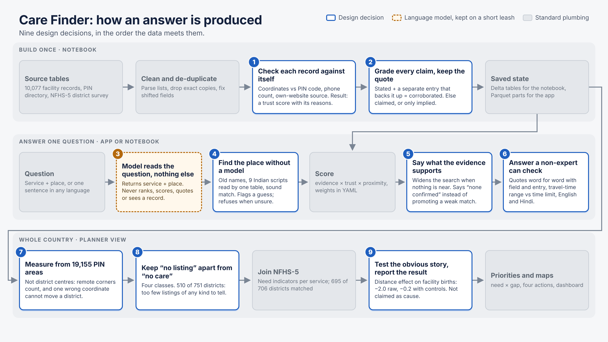
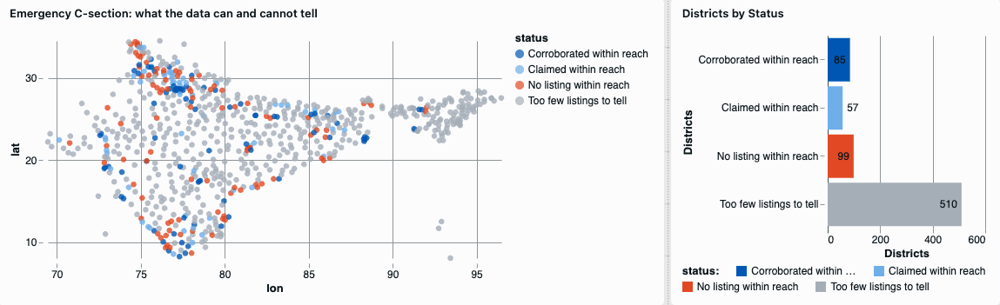

<div align="center">
  
# CareProof
  
**CMU Datathon 2026** · CMU DSC with Databricks

_Care you can find, evidence you can check_

[](https://datathon-2026-7474652223537473.aws.databricksapps.com/)
[](https://youtu.be/A1XgduBgVtY)

**Team member**: [Vincent Pai](https://github.com/Bai1026) & [Daphne Yang](https://github.com/Daphne0127)

</div>

<!-- TODO: replace the Video link with the demo video URL -->

Someone in India needs dialysis, an emergency C-section or a NICU bed, and has to decide where to go.
CareProof takes a service and a location, returns the best facility options from the Virtue Foundation
dataset, and shows the exact record entries each recommendation rests on. When the records cannot
support an answer, it says so.

`score = evidence x trust x proximity`

- [The problem](#the-problem)
- [The data](#the-data)
- [What CareProof delivers](#what-careproof-delivers)
- [How it works](#how-it-works)
- [What the data can and cannot tell](#what-the-data-can-and-cannot-tell)
- [Run on Databricks](#run-on-databricks)
- [Files](#files)
- [Single-file version](#single-file-version)
- [Web app](#web-app)
- [District view](#district-view)
- [Change the method](#change-the-method)
- [Languages](#languages)
- [Use from code](#use-from-code)
- [Test](#test)
- [Not yet done, and limits](#not-yet-done-and-limits)

## The problem

Going to a facility that turns out not to offer the service costs travel time, and in an emergency the
patient may not have it. The person deciding may be neither a clinician nor a data analyst.

The only source is a directory of about 10,000 facilities, compiled from web pages and listings. Nothing
in it is verified. Every field is what a facility, or a page about it, says. A search tool that repeats
those claims with confidence gives wrong answers that look right.

The challenge asks for five things:

| Requirement                                        | How CareProof meets it                                                                    |
| -------------------------------------------------- | ----------------------------------------------------------------------------------------- |
| Given a service and a location, return the best facility options | Ranked options, scored by evidence, trust and proximity                     |
| Cite the facility's own text for every claim, score and ranking  | Each line is quoted word for word, with the field and entry it was copied from |
| Communicate uncertainty                            | Three grades in words, a visible trust score, and "cannot tell" as a result of its own    |
| Support a non-technical workflow                   | A web app with eight service tiles and a free-text question box, in English and Hindi     |
| Run on Databricks Free Edition with the given data | One serverless notebook, no cluster, no external API key                                  |

## The data

The dataset cannot be used as it comes. Three things are wrong with it, and each one changes the design.

**1. The records are claims, and many are weak.** Counts are from the full run on 10,088 rows.

| What we found                                                    | Records         | What CareProof does                                              |
| ---------------------------------------------------------------- | --------------- | ---------------------------------------------------------------- |
| Exact duplicate rows                                             | 11              | Removed, leaving 10,077 facilities                               |
| No first-party source (the facility's own site or page)          | 5,349 (53.1%)   | Trust reduced by 0.10                                            |
| Coordinates disagree with the PIN code                           | 1,040 (10.3%)   | Trust reduced by 0.15, and the answer says so                    |
| Probably several facilities merged into one (11 or more phones)  | 577 (5.7%)      | Trust reduced by 0.20, and the answer says so                    |

Two smaller checks work the same way: coordinates outside India (0.10) and columns shifted out of place
(0.20). Trust starts at 1.0 and never goes below 0.30.

**2. There is no "offers this service" column.** What a facility does is spread across five fields:
three free-text lists (`procedure`, `capability`, `equipment`), the sentences of `description`, and the
`specialties` codes. CareProof reads all five for each of eight services and grades what it finds:

| Grade        | Meaning                                                                 | Weight |
| ------------ | ----------------------------------------------------------------------- | ------ |
| Corroborated | The record states the service, and a separate entry backs it up         | 1.0    |
| Claimed      | The record states the service, and nothing backs it up                  | 0.6    |
| Implied      | Only a related detail, not enough to confirm                            | 0.25   |

This produced 25,768 graded facility and service pairs, resting on 74,883 quoted entries. Every quote
keeps its field and entry number, so a reader can find it in the record.

**3. The coverage is uneven.** 88% of the records are private facilities and about 5% are public, so
rural public hospitals are often missing. In most of the country a missing listing says more about the
dataset than about care. This is why the district view has a class of its own for "Too few listings to
tell".

Two more sources had to be cleaned before they could be joined:

- **India Post PIN directory.** 395 PIN areas had coordinates far from their own district and were
  dropped, leaving 19,155. Place names also arrive in old spellings, abbreviations and nine Indian
  scripts, so the place lookup has its own alias list and reading rules (see [Languages](#languages)).
- **NFHS-5 district survey.** District names differ from the directory's (renamed and split districts).
  A dedicated matcher joins 695 of 706. Values the survey suppressed are treated as missing, and values
  it marks as based on few cases are kept and counted.

## What CareProof delivers

The goal is an answer that a non-expert can act on and check, and a clear statement of where the data
cannot give one.

**For one question.** A short list of facilities, each answering three things: do they offer it, is the
information reliable, how far is it.

- The grade comes in words before any number.
- Every supporting line is a quote from the record, with its field and entry number.
- Problems with the record are shown on the card, not hidden in the score.
- Travel time is a range, compared with a target time for the service where one is set.
- If nothing nearby is corroborated, the headline says so.
- The question can be typed in any language. In our own test sets, 13 of 13 questions and 20 of 20
  non-English place names were read correctly.

**For the whole country.** Each of 751 districts is put in one of four classes for each of eight
services. For the four services with a matching NFHS-5 indicator, districts are also ranked by
`need x gap`. For emergency C-section that gives four lists and four actions:

| Class                     | Districts | Action                                                       |
| ------------------------- | --------- | ------------------------------------------------------------ |
| Corroborated within reach | 85        | Lowest priority                                              |
| Claimed within reach      | 57        | Verify the claim. A phone call is the cheapest new capacity. |
| No listing within reach   | 99        | Check on the ground, starting where need is highest          |
| Too few listings to tell  | 510       | Count facilities first, before any ranking                   |

**What it does not claim.** The grades have not been validated by hand, travel time is an estimate, and
distance to a listed facility mostly follows development: once literacy, clean fuel and electricity are
held constant, its relation to survey outcomes cannot be told from zero. See
[Not yet done, and limits](#not-yet-done-and-limits).

## How it works



**Figure 1. How an answer is produced.** Three stages share one saved state. Blue boxes are the nine
design decisions, in the order the data meets them. The dashed box is the only place a language model
is used: it reads the question and returns a service and a place, and never ranks, scores, quotes or
sees a record. Grey boxes are standard plumbing.

| Stage               | What happens                                                                                                                            | Where                                                            |
| ------------------- | --------------------------------------------------------------------------------------------------------------------------------------- | ---------------------------------------------------------------- |
| Build once          | Clean the records, check each one against itself for a trust score, grade every claim and keep the quote, save the state.               | Notebook sections 0 to 4, `cf.build_state`                       |
| Answer one question | Read the question, find the place without a model, score, say only what the evidence supports, return an answer a non-expert can check. | Notebook sections 5 and 7, the web app, `cf.find_care`, `cf.ask` |
| Whole country       | Measure reach from every PIN area, keep "no listing" apart from "no care", join the NFHS-5 survey, rank districts by `need x gap`.      | Notebook section 9                                               |

## What the data can and cannot tell



**Figure 2. Emergency C-section across India's 751 districts: the data supports a conclusion for only
a third of them.** Each dot is one district at its own location, so together the dots trace the shape
of India. The colour is one of four classes:

| Class                                 | Districts | Meaning                                                                                                                                                   |
| ------------------------------------- | --------- | --------------------------------------------------------------------------------------------------------------------------------------------------------- |
| Corroborated within reach (dark blue) | 85        | A facility within 25 km states the service, and a separate entry in its record backs the claim up.                                                        |
| Claimed within reach (light blue)     | 57        | A facility within 25 km states the service, and nothing backs it up.                                                                                      |
| No listing within reach (orange)      | 99        | Many facilities are listed nearby and none of them states the service. The most likely real gaps, and the first to check on the ground.                   |
| Too few listings to tell (grey)       | 510       | Almost no facility of any kind is listed nearby. This is a gap in the dataset (88% of its records are private facilities), not evidence of a gap in care. |

A district is put in a class when at least half of its PIN areas are in it. No listing is not the same
as no care:

- **Grey is two thirds of the country.** "Not listed" cannot be read as "not available".
- **Orange and grey are kept apart.** Counting every district with no listed provider as a gap gives 609. Only 99 of those have enough data behind them, and that is where field verification should go.
- **Blue is concentrated in the north-west and the south.** The centre and the north-east are almost
  entirely grey.

The map applies the same rule as a single answer. An answer keeps "Corroborated", "Claimed, not
corroborated" and "Implied only" apart, and says so when nothing nearby states the service; the map
does the same for the whole country. "Cannot tell" is reported as a result of its own, with 510
districts in it, not as a confidence score next to an answer.

## Run on Databricks

1. Put the whole folder in the workspace. Easiest with the Git folder: commit these files to the
   repository, then Pull in Databricks.
2. Open `care_finder_notebook` and Run all.
3. Change the widgets at the top and re-run section 5 (fields) or section 7 (plain-language question).

After editing a YAML file or `carefinder.py`, re-run from section 0.

## Files

| File                                     | What it is                                                                                               |
| ---------------------------------------- | -------------------------------------------------------------------------------------------------------- |
| `care_finder_notebook.py`                | Databricks notebook. No logic: loads data, calls the library, saves tables, shows results.               |
| `carefinder.py`                          | The library. Pure pandas, no Spark.                                                                      |
| `scoring.yaml`                           | Every number: distance limits, penalties, grade values, travel-time assumptions.                         |
| `services.yaml`                          | What counts as evidence for each service, as plain term lists.                                           |
| `location_aliases.yaml`                  | Other names for places (old names, spellings, abbreviations, names in Indian scripts), and filler words. |
| `answer.html.j2`                         | The answer's HTML template.                                                                              |
| `services_generated.yaml`                | Created at run time: definitions a language model wrote for services not in `services.yaml`.             |
| `test_carefinder.py`                     | Tests. Run after any change.                                                                             |
| `app.py`, `app.yaml`, `requirements.txt` | The web app for Databricks Apps. A thin screen over the library.                                         |
| `build_submission.py`                    | Packs everything into one notebook, `care_finder_submission.ipynb`.                                      |
| `care_finder_submission.ipynb`           | The single-file version, generated. Do not edit by hand.                                                 |
| `sample_rows.tsv`                        | Five real rows used by the tests. Git-ignored: do not publish dataset rows.                              |
| `doc/`                                   | The figures in this README. Not needed to run anything.                                                  |

Everything except `doc/` must sit in the same folder.

## Single-file version

`python build_submission.py` writes `care_finder_submission.ipynb`. It carries the library, the YAML
files and the template as text cells, writes them to a temporary folder when it runs, and imports the
library from there, so it needs no other file. Re-run the script after any change.

To hand in a notebook with its outputs: import the `.ipynb` into a Databricks workspace folder, Run all,
then File > Export > IPython Notebook.

## Web app

Section 8 of the notebook writes a deployable folder to `/Workspace/Users/<you>/care_finder_app`: the
app, the library, the settings and the current state as Parquet files in `data/` (split so that no file
is over the 10 MB limit of Databricks Apps).

1. Compute > Apps > Create app > Create a custom app.
2. Deploy > From workspace > that folder.
3. Optional, for the question box: add the model's serving endpoint as an app resource with "Can query".

Only people with an account in the workspace can open the app (Share > add them with "Can use"); it
cannot be made public. On Free Edition it stops 24 hours after it was started.

Run it on a laptop: `CARE_FINDER_DATA=<folder with the parquet files> python app.py`, then open
http://localhost:8000. `data/` is git-ignored: it holds dataset rows.

## District view

Section 9 of the notebook answers the planner's question: where is each service out of reach, and where
does that matter most. Figure 2 is its output for one service.

- `pin_access` measures, for every PIN area, the distance to the nearest facility that states each
  service and to the nearest one whose claim is corroborated.
- `district_access` puts each district in one of four classes. The last one, "Too few listings to
  tell", keeps a gap in the data from being reported as a gap in care.
- `district_table` joins the NFHS-5 district survey and computes `priority = need x gap`. The need
  indicators per service are listed in `scoring.yaml` under `district_view`.
- `access_relation` estimates how a survey outcome changes with distance, with and without controls.

The limits behind the classes are in `scoring.yaml`: "within reach" is `half_km` for the service's
urgency (25 km for an emergency), "too few listings" is fewer than `sparse_max_facilities` (25)
facilities of any kind within `sparse_radius_km` (50 km), and a district takes a class at
`majority_share` (0.5) of its PIN areas.

## Change the method

- A service's terms: edit `services.yaml`. The header of that file explains the matching rules.
- A new service: add an entry to `services.yaml`, or ask for it in section 7 and review what the model
  wrote in `services_generated.yaml`, then move it into `services.yaml`.
- Weights and distances: edit `scoring.yaml`.
- A place name that is not recognised: add a group to `location_aliases.yaml`. Section 3c of the notebook
  lists groups that matched nothing and suggests pairs found in the data.

## Languages

The records and the place names in the data are English, so everything is matched in English.
Input in other languages is handled in three layers:

| Input                                                                     | How                                                                                                                                                                                                                                       | Model needed |
| ------------------------------------------------------------------------- | ----------------------------------------------------------------------------------------------------------------------------------------------------------------------------------------------------------------------------------------- | ------------ |
| Digits in any script (`८००००१`), accents (`Puné`)                         | Normalised before anything else.                                                                                                                                                                                                          | No           |
| A place name in an Indian script that is listed (`पटना`, `கோவை`, `لکھنؤ`) | `other_scripts` in `location_aliases.yaml`.                                                                                                                                                                                               | No           |
| A place name in an Indian script that is not listed (`सीतामढ़ी`)          | Read letter by letter (`sitamrhi`) and matched to the place whose consonants are the same. The answer says this was an automatic reading. Nine scripts: Devanagari, Bengali, Gurmukhi, Gujarati, Odia, Tamil, Telugu, Kannada, Malayalam. | No           |
| A whole question in any language                                          | The model returns the service in English and the place in Latin letters. The answer shows that reading on top.                                                                                                                            | Yes          |

Not handled: place names in Arabic script (Urdu) or other scripts that are not listed, without a model
(the answer asks for English letters or a PIN code); answers in a language other than English; records
whose own text is not English (section 3b counts them; they can never count as evidence).

To add a name: `other_scripts` for a name in another script, `filler_words` for words such as "near".

## Use from code

```python
import carefinder as cf
state = cf.build_state(raw_facilities_df, pin_directory_df)     # once
result, html = cf.find_care(state, "dialysis", "Jaipur")
result, html = cf.ask(state, "My patient needs dialysis near Gaya", llm)   # llm: any function str -> str

tables = cf.state_to_tables(state)        # six pandas DataFrames to save
state = cf.state_from_tables(tables)      # rebuild without re-running the pipeline
```

Ranking is three separate steps: `score_candidates` -> `pick` -> `verdict`.

## Test

```
python test_carefinder.py
```

## Not yet done, and limits

- Service definitions, time targets and place aliases have not been reviewed by a clinician or checked
  against the full data.
- Travel time is a range estimated from straight-line distance, not a route calculation.
- The evidence grades have not been validated by hand (notebook section 6).
- Matching is by keyword rules. It misses unusual wording and can misread a sentence.
